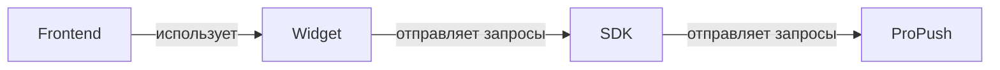
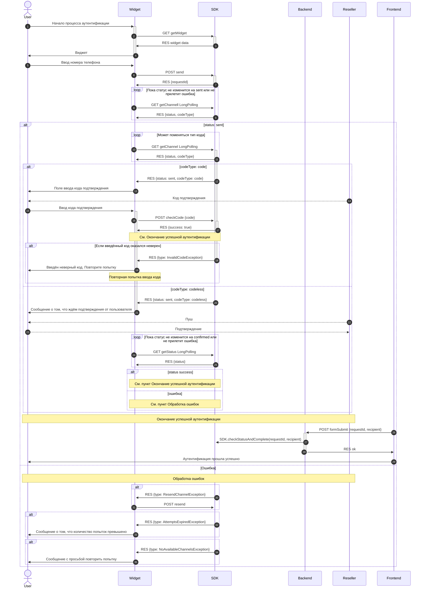

# Документация для разработчиков

## Общая информация

SDK упрощает взаимодействие внешних систем авторизации с обработчиком OTP на платформе SIGMA messaging.

### Клиентские компоненты

Для удобства работы есть уже готовыe компоненты:
- **UI-виджет** — фронтенд-компонент, отображаемый пользователям.
- **SDK** — серверная библиотека для интеграции.

### Принципы безопасности

**Важно!** Чтобы исключить переиспользование OTP-сессии, всегда закрывайте её принудительно после успешной проверки кода. Для этого используйте эндпоинты `otp-handler`.

**Способы закрытия сессии:**

1. **Рекомендуемый.** Проверить статус и сразу закрыть сессию методом `checkStatusAndComplete`. Действия выполняются атомарно, благодаря чему при параллельных вызовах успешным будет только один из них.
2. **Упрощённый.** Закрыть сессию методом `complete` без проверки её статуса. Менее надёжен, чем первый способ, но является минимальным условием корректного завершения авторизации.
3. **Без использования SDK.** Закрыть сессию вашим собственным методом — через прямое обращение к эндпоинту.

## Использование готового виджета для фронтенда

[Подробная документация по подключению виджета](https://www.npmjs.com/package/@sigmamessaging/otp-widget).

## Написание собственного виджета

Ваш виджет должен направлять запросы на эндпоинты SDK ([API sdk](./api/sdk/index.md)) и следовать логике запросов, представленной на диаграмме работы.

## Использование готового SDK для бэкенда

Для `Node.js` доступен готовый SDK, который предоставляет готовые методы для работы с API и контроллеры для работы с виджетом на фронтенде. Также в папке `typescript-example` есть примеры использования SDK без виджета.

[Документация по SDK](./DOCS_SDK.md).

## Написание своего SDK

В готовом SDK для Node.js из дополнительной логики реализована интеграция с CAPTCHA-провайдерами. В остальном SDK только отправляет запросы на сервис ProPush (otp-handler). API системы открыт, что позволяет вам написать SDK на предпочтительном для вас языке. Ваш SDK должен отправлять запросы на сервис `otp-handler` ([API otp-handler](./api/otp-handler/index.md)) и обеспечивать эндпоинты для виджета на фронтенде ([API sdk](./api/sdk/index.md)).

## Общая схема работы

### Диаграмма работы

**Участники процесса:**
- User — конечный пользователь.
- Frontend — ваш фронтенд.
- Widget — виджет, интегрированный в ваш фронтенд.
- SDK — серверный SDK, выступающий прокси между виджетом и сервисом SIGMA.
- Backend — бэкенд-сервер вашего приложения.
- Reseller — сторонний сервис, доставляющий код или push-уведомление. Примеры: SMS-провайдер, банковское приложение.

#### Инициализация виджета

1. Начало процесса аутентификации
2. Фронтенд запрашивает данные самого виджета [getWidget](./api/sdk/get-widget.md)

#### Запуск процесса аутентификации
5. Пользователь вводит номер телефона и запускает процесс аутентификации
6. Фронтенд отправляет запрос на запуск процесса аутентификации [send](./api/sdk/send.md)
7. бэкенд отправляет идентификатор процесса аутентификации и на стороне сервиса SIGMA начинается процесс выбора и запуска подходящего канала.
8. Фронтенд делает запрос long polling [getChannelLongPolling](./api/sdk/get-channel-long-polling.md) и ждёт пока статус канала не измениться на `sent` либо придёт ошибка.
10. Важно: Даже если в ответе от [getChannelLongPolling](./api/sdk/get-channel-long-polling.md) в пункте `8` пришёл `sent` опрос необходимо продолжать. В некоторых случаях система сервис SIGMA может динамически изменить канал с `code` на `codeless` (и наоборот) без изменения общего статуса `sent`.

#### Подтверждение по коду (`code`)

Тип канала `code` означает, что пользователь должен будет ввести код который придёт к нему. И этот код должен будет быть передан в SDK и дальше для проверки и фронтенд узнает об подтверждении сразу в ответе.

12. В случае ответа от [getChannelLongPolling](./api/sdk/get-channel-long-polling.md) что статус канала `sent` и тип канала `code`, фронтенд должен отрисовать поле ввода кода так как код подтверждения уже отправлен пользователю.
15. Пользователь вводит код подтверждения.
16. Фронтенд отправляет запрос на эндпоинт [checkCode](./api/sdk/check-code.md) для проверки кода.
17. Код отправленный на эндпоинт оказался верный и дальше см. пункт окончания процесса аутентификации.
18. Код отправленный на эндпоинт оказался неверный и вернулась ошибка `InvalidCodeException`. В данном случае надо сообщить пользователю об этом и начать заново с пункта `15`.

#### Подтверждение без кода (`codeless`)

Тип канала `codeless` означает, что пользователю приходит push или другой бескодовый вариант подтверждения. Отличие от каналов с кодом в том, что подтверждение без кода поступает напрямую в сервис SIGMA и фронтенд узнаёт о таком подтверждении «асинхронно» с помощью long-polling-запросов.

20. Если после ответа от эндпоинта [getChannelLongPolling](./api/sdk/get-channel-long-polling.md) тип канала оказался `codeless` то пользователь не вводит код, а успешность аутентификации проверяется фронтендом с помощью запроса long polling [getStatusLongPolling](./api/sdk/get-status-long-polling.md).
24. Запрос на этот эндпоинт. И в зависимости от ответа — либо успешное окончание процесса аутентификации либо обработка ошибок.

    Тип канала (`codeType`) может измениться в процессе запроса. Статус `wait` означает, что запрос всё ещё обрабатывается. Кроме того, при смене `codeType` может прийти ответ `ChannelChangedException`. Поэтому запрос на `getChannel longPolling` надо делать постоянно. При этом ориентироваться надо на статус `sent`. Он означает, что пользователю уже что-то отправлено. Следовательно, при статусе `wait` — ждём независимо от типа канала. При смене статуса на `sent`:
    — если тип канала `code`, рисуем форму для ввода кода.
    — если тип канала `codeless` — отправляем long polling на проверку пуша.

#### Успешное окончание аутентификации

Это критически важный шаг безопасности. Проверка итогового статуса и фиксация результата должны выполняться на стороне вашего сервера, а не фронтенда, чтобы избежать подделки запросов.

26. После успешного ответа на проверку кода [checkCode](./api/sdk/check-code.md) либо успешного ответа от [getStatusLongPolling](./api/sdk/get-status-long-polling.md) начинается процесс аутентификации который должен происходить на стороне бэкенда и инициализирует её уже не виджет а фронтенд.
27. бэкенд вызывает метод SDK [checkStatusAndComplete](./docs/otp-sdk.sigmaotpsdk.checkstatusandcomplete.md) и сообщает об успешности аутентификации.

#### Обработка ошибок

30. При ошибке `ResendChannelException` необходимо сделать запрос на эндпоинт [resend](./api/sdk/resend.md) и тем самым перезапуститься текущий канал либо запуститься следующий. При ошибке `ChannelChangedException` надо заново вызвать getChannel что бы получить и отрисовать канал заново так как данный ответ возникает при попытке перезапуска текущего канала или при попытке запуска следующего канала (если попытки перезапуска текущего канала исчерпаны). При остальных ошибках конец процесса аутентификации и просьба начать процесс заново пользователю.

